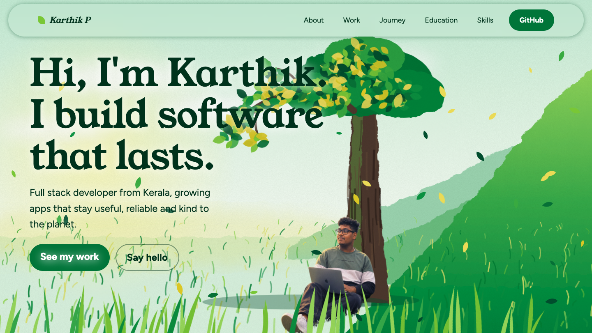

# Karthik P :: Portfolio Website

A hand-crafted, single-page portfolio built with **vanilla HTML, CSS and JavaScript** — no frameworks, no build tools. The hero features a fully procedural SVG nature scene with parallax layers, canvas-driven wind leaves, and scroll-reveal animations, all rendered at 60 fps.

> **Live site:** _[https://karthik-joseph.github.io/portfolio_website/]_

---

## Preview



---

## Tech Stack

| Layer | Technology |
|-------|-----------|
| **Markup** | Semantic HTML5 |
| **Styling** | Vanilla CSS3 (custom properties, `clamp()`, `grid`, `flexbox`) |
| **Logic** | Vanilla JavaScript (ES5-compatible IIFE pattern) |
| **Fonts** | [Young Serif](https://fonts.google.com/specimen/Young+Serif) · [Figtree](https://fonts.google.com/specimen/Figtree) (Google Fonts) |
| **Graphics** | Inline SVG with procedural generation + HTML5 Canvas |
| **Build** | None — zero dependencies, zero bundlers |

---

## Project Structure

```
portfolio_website/
├── index.html              # Single-page entry point (all sections)
├── style.css               # Complete stylesheet with design tokens
├── script.js               # Scene generation, parallax, canvas & scroll-reveal
├── assets/
│   ├── fonts/              # (reserved for self-hosted fonts)
│   └── images/
│       ├── hero_character.webp   # Illustrated character for the hero scene
│       ├── image/
│       │   └── leaf.png          # Favicon / leaf icon
│       │   └── screenshot.png
│       └── svg/                  # (reserved for static SVG assets)
└── README.md
```

---

## Design System

### Color Palette

The palette is rooted in a **nature / green theme**, defined as CSS custom properties in `:root`:

| Token | Value | Usage |
|-------|-------|-------|
| `--bg` | `#fbfef8` | Page background — warm off-white |
| `--ink` | `#10301d` | Primary text — deep forest green |
| `--mut` | `#4b6a55` | Muted / secondary text |
| `--card` | `#fff` | Card surfaces |
| `--line` | `#d4e8cc` | Borders and dividers |
| `--blue` | `#23703c` | Accent / CTA green |
| `--g` | `#6fae4f` | Secondary accent — brighter green |
| `--sky` | `#eaf6e2` | Band / section backgrounds |

The SVG scene uses its own gradient stops (`#c9ead6` → `#e4f5e6` → `#fbfef8` for the sky, `#a8d46a` → `#5aa653` → `#2d7a40` for the field) to create a painterly landscape feel.

### Typography

| Element | Font | Weight | Size |
|---------|------|--------|------|
| **Headings** (`h1`, `h2`, `h3`) | **Young Serif** (serif) | 400 | `clamp(36px, 5vw, 64px)` for `h2`; `clamp(44px, 6.4vw, 92px)` for `h1` |
| **Body** | **Figtree** (sans-serif) | 400 / 500 / 700 | `24px` desktop, `20px` mobile (via `--fs`) |
| **Nav links** | Figtree | 400 | `1.1rem` |
| **Tags / badges** | Figtree | 400 | `18px` |
| **Stat numbers** | Young Serif | 400 | `clamp(40px, 5vw, 60px)` |

**Fallback stacks:**
- Headings: `"Young Serif", Georgia, serif`
- Body: `Figtree, system-ui, sans-serif`

---

## Animations & Interactions

### 1. Hero Scene Wipe
The entire SVG scene is revealed with a **clip-path wipe** animation:
```css
@keyframes wipe { to { clip-path: inset(0); } }
```
Duration: `1.7s` with a `cubic-bezier(0.7, 0, 0.2, 1)` easing for a cinematic reveal.

### 2. Layer Slide-In (`lyin`)
Each parallax layer slides in from the right with a staggered delay based on its `--i` CSS variable:
```css
animation-delay: calc((var(--i) * 0.2s) + 0.3s);
```

### 3. Tree Branch Sway
The tree branch continuously oscillates using an **infinite alternate** animation:
```css
@keyframes sway {
  from { transform: rotate(-1.8deg); }
  to   { transform: rotate(2.4deg); }
}
```

### 4. Leaf Clusters Float (`fl`)
Procedurally generated leaf clusters rotate and translate with randomized `animation-delay` and `animation-duration` for an organic feel.

### 5. Grass Blades (`gs`)
Foreground grass blades skew left and right via an infinite animation, each with its own timing offset.

### 6. Wind Leaves (Canvas)
A **Canvas 2D** overlay renders ~42 leaf particles (20 on mobile) that drift across the viewport. Each leaf has:
- Randomized velocity, spin rate, size, and colour
- Sinusoidal wind gusts
- Auto-respawn when off-screen
- Pauses when scrolled past the hero for performance

### 7. Mouse Parallax
Six depth layers (`data-d` attributes: 4, 8, 12, 24, 26, 34) shift in response to cursor position using `requestAnimationFrame` with lerped easing (`cx += (mx - cx) * 0.06`).

### 8. Scroll Reveal
Elements with the `.rv` class are observed by an `IntersectionObserver` (threshold: `0.12`). On intersection the `.in` class is added — you can hook CSS transitions to this class for fade/slide effects.

### 9. Nav Entrance
The navbar starts translated off-screen (`translateY(-110%)`) and slides down when the `.ready` class is added to `<body>` after a `2.6s` timeout.

### 10. Reduced Motion Support
All animations respect `prefers-reduced-motion: reduce`:
- CSS animations and transitions are set to `0.01s`
- Canvas wind-leaf loop is entirely skipped
- Elements render in their final state immediately

---

## Sections Overview

| Section | ID | Description |
|---------|----|-------------|
| **Navigation** | — | Fixed pill-shaped nav with backdrop blur and box-shadow. Links collapse on mobile; GitHub CTA stays visible. |
| **Hero** | `#top` | Full-viewport illustrated SVG scene — sky, hills, tree, character — with canvas leaf overlay and hero text. |
| **About** | `#about` | Two-column grid with bio paragraph and 4 stat cards (years building, response improvement, bundle reduction, devs mentored). |
| **Work** | `#work` | Auto-fit card grid showcasing projects: Impactly, Deyoze IoT, Marketplace platforms, Resort booking system. Each card has hover lift, gradient side-bars, and tech tags. |
| **Journey** | `#path` | Vertical timeline with leaf-shaped dot markers for work experience at Ribos Technologies, Steyp, and freelance. |
| **Education** | `#education` | Card grid for BCA, Higher Secondary, and SSLC with year/score badges. |
| **Skills** | `#skills` | Four-column grid (Frontend, Backend, Data & Auth, AI & Workflow) separated by green top-borders. |
| **GitHub CTA** | — | Full-width gradient banner linking to `github.com/karthik-joseph`. |
| **Footer** | `#contact` | Centred contact section with email, phone, and LinkedIn buttons. |

---

## Getting Started

### Prerequisites
- A modern web browser (Chrome, Firefox, Safari, Edge)
- No Node.js, npm, or build tools required

## Accessibility

- Semantic HTML5 elements (`<nav>`, `<header>`, `<section>`, `<footer>`, `<article>`)
- SVG scene includes an `aria-label` describing the illustration
- `prefers-reduced-motion` fully respected (CSS + JS)
- `safe-area-inset` padding for notched / dynamic-island devices
- External links use `rel="noopener"` and `target="_blank"`
- Responsive from `320px` to ultrawide

---

## License

This project is personal portfolio work by **Karthik P**. Feel free to use the code structure as inspiration for your own portfolio, but please replace all personal content (text, images, and branding).

---

## Contact

- **Email:** [karthikkarthikpwork@gmail.com](mailto:karthikkarthikpwork@gmail.com)
- **Phone:** [+91 73064 01885](tel:+917306401885)
- **LinkedIn:** [linkedin.com/in/karthik-p-karthik](https://linkedin.com/in/karthik-p-karthik)
- **GitHub:** [github.com/karthik-joseph](https://github.com/karthik-joseph)
